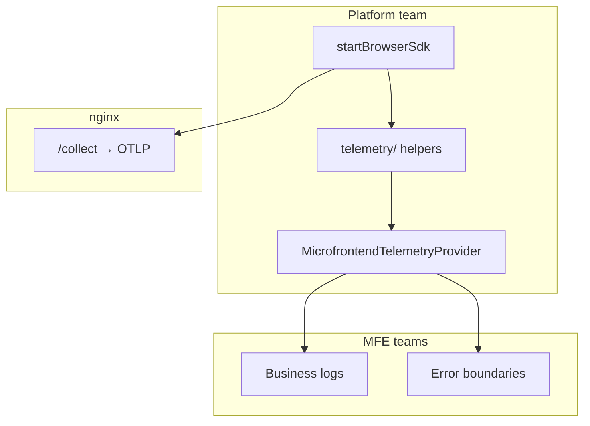

# One SPA, four teams: instrumenting Elaspic microfrontends with OpenTelemetry

Elaspic is a photo gallery React app: users sign in, upload pictures, and browse other people’s galleries. The UI ships as a **single** SPA, but four engineering teams own different slices of it—login/register (identity), your gallery (pics), browsing users (users), and the shell that wires routing and auth together (platform).

When everyone shares one bundle and one Real User Monitoring agent, telemetry piles up in one place. Pics-team upload errors hide in users-team gallery navigation noise. Identity login failures look like anonymous frontend exceptions. Each team needs the same distributed trace and log pipeline, with a **reliable way to filter by the team that owns the code**.

This post walks through how we instrumented Elaspic using the [Elastic Distribution of OpenTelemetry Browser](https://www.elastic.co/docs/reference/opentelemetry/edot-sdks/browser) (`@elastic/opentelemetry-browser` in this repo). The design follows our [instrumentation plan](./INSTRUMENTATION_PLAN.md): one SDK, one export path, team dimensions on spans and logs—not four separate `service.name` values.

---

## The app we are instrumenting

Team boundaries map to folders under `ui/src/microfrontends/`, lazy-loaded from `App.jsx`:

| Team | Routes | Code |
| --- | --- | --- |
| **identity** | `/login`, `/register` | `microfrontends/login/`, `register/` |
| **pics** | `/pics`, `/pics/:picId` | `microfrontends/pics/` |
| **users** | `/users`, … | `microfrontends/users/` |
| **platform** | shell, auth, shared API client | `shell/`, `auth/`, `api/client.js` |

The stack already exposes an OTLP reverse proxy at the edge:

```text
Browser  ──► nginx :8080
              ├── /api/*     → Express API
              ├── /collect/* → OTLP (API key on server only)
              └── /*         → static UI
```

No API keys ship to the browser; nginx injects `Authorization` when forwarding `/collect/`. The UI never had RUM turned on yet—that is what we are adding.

---

## Design principle: one RUM agent, many attribution labels

OpenTelemetry in the browser works best with **one** `startBrowserSdk()` call per page. A second agent (another EDOT instance, legacy Elastic RUM, or a duplicate auto-instrumentation package) causes double spans, broken context, and painful debugging.

So the whole app is one APM service: `service.name = elaspic-ui`. Team ownership is expressed with **attributes**, chiefly:

- `elaspic.ui.team` — `identity`, `pics`, `users`, or `platform`
- `elaspic.ui.route` — React Router **pattern** (e.g. `/pics/:picId`), not raw UUIDs
- `elaspic.ui.feature` — optional, for business events like `upload`

Every team uses tracers scoped as `io.elaspic.ui.<team>` so Discover and APM can filter on scope or attributes alike.



---

## Step 1: Install EDOT and bootstrap before React

Add the dependency (from npm or the monorepo package):

```bash
cd ui
npm install @elastic/opentelemetry-browser
```

In a monorepo checkout, you can use `file:../../../packages/opentelemetry-browser` and run `npm run build` in that package first.

The entry point must start the SDK **before** anything that touches `fetch` or the DOM. In `main.jsx`, import telemetry first:

```js
// ui/src/main.jsx
import './telemetry/init.js';

import { StrictMode } from 'react';
import { createRoot } from 'react-dom/client';
// … rest of existing imports
```

Create `ui/src/telemetry/init.js` (platform-owned):

```js
import { startBrowserSdk } from '@elastic/opentelemetry-browser';

const enabled = import.meta.env.VITE_OTEL_ENABLED !== 'false';

export const browserSdk = enabled
  ? startBrowserSdk({
      serviceName: 'elaspic-ui',
      serviceVersion: import.meta.env.VITE_APP_VERSION ?? 'dev',
      logLevel: import.meta.env.DEV ? 'info' : 'warn',
      resourceAttributes: {
        'deployment.environment.name':
          import.meta.env.VITE_DEPLOYMENT_ENV ?? 'development',
      },
      exportConfig: {
        // Same origin; nginx adds the API key
        url: `${window.location.origin}/collect`,
      },
      session: {
        sampleRate: Number(import.meta.env.VITE_OTEL_SESSION_SAMPLE_RATE ?? 1),
      },
      ignoreFetchUrls: [/\/collect\//],
    })
  : null;
```

After deploy, Elastic Observability should show a `elaspic-ui` service with automatic **document load** traces, **fetch** spans for `/api/*`, navigation and click **logs**, Core Web Vitals, and uncaught errors—before any microfrontend team writes a line of custom instrumentation.

Ignore `/collect/` so export requests do not become nested `external.http` spans.

---

## Step 2: A small SDK for microfrontend teams

Teams should not import `@elastic/opentelemetry-browser` or configure exporters. Platform exposes `ui/src/telemetry/index.js`:

```js
import { context, trace, logs, SeverityNumber } from '@opentelemetry/api';
import { TEAM_CONTEXT_KEY, getActiveTeamContext } from './context.js';

const APP_VERSION = import.meta.env.VITE_APP_VERSION ?? 'dev';

export function getTeamTracer(team) {
  return trace.getTracer(`io.elaspic.ui.${team}`, APP_VERSION);
}

export function getTeamLogger(team, loggerName = 'elaspic.ui') {
  return logs.getLogger(`io.elaspic.ui.${team}`, loggerName);
}

/** @param {{ team: string; event: string; attributes?: Record<string, string|number|boolean> }} opts */
export function recordUiEvent({ team, event, attributes = {} }) {
  const logger = getTeamLogger(team);
  logger.emit({
    severityNumber: SeverityNumber.INFO,
    severityText: 'INFO',
    body: event,
    attributes: {
      'elaspic.ui.team': team,
      'elaspic.ui.event': event,
      ...attributes,
    },
  });
}

export function withTeamContext(team, routePattern, fn) {
  const ctx = getActiveTeamContext() ?? {};
  const next = context.active().setValue(TEAM_CONTEXT_KEY, {
    ...ctx,
    team,
    route: routePattern,
  });
  return context.with(next, fn);
}

export { getActiveTeamContext } from './context.js';
```

`context.js` holds a single `TEAM_CONTEXT_KEY` in OpenTelemetry context—the hook that lets shared `apiFetch` calls “see” which team owns the current screen:

```js
import { context } from '@opentelemetry/api';

export const TEAM_CONTEXT_KEY = Symbol('elaspic.ui.teamContext');

export function getActiveTeamContext() {
  return context.active().getValue(TEAM_CONTEXT_KEY);
}
```

---

## Step 3: Route-scoped team attribution

EDOT’s automatic navigation logs include the URL path, so you can already filter `url.path: /pics*` in Discover. For **custom** events and optional parent spans, we wrap each lazy-loaded microfrontend route.

`resolveTeam.js` maps pathname prefixes to teams:

```js
const ROUTES = [
  { prefix: '/login', team: 'identity', microfrontend: 'login' },
  { prefix: '/register', team: 'identity', microfrontend: 'register' },
  { prefix: '/pics', team: 'pics', microfrontend: 'pics' },
  { prefix: '/users', team: 'users', microfrontend: 'users' },
];

export function resolveTeamFromPath(pathname) {
  const match = ROUTES.find((r) => pathname === r.prefix || pathname.startsWith(`${r.prefix}/`));
  if (match) return match;
  return { team: 'platform', microfrontend: 'shell' };
}

/** Map useParams() + route template to a stable pattern string */
export function routePattern(pathname) {
  if (/^\/pics\/[^/]+$/.test(pathname)) return '/pics/:picId';
  if (/^\/users\/[^/]+\/pics\/[^/]+$/.test(pathname)) return '/users/:userId/pics/:picId';
  if (/^\/users\/[^/]+$/.test(pathname)) return '/users/:userId';
  return pathname;
}
```

`MicrofrontendTelemetryProvider.jsx`:

```jsx
import { useEffect } from 'react';
import { useLocation } from 'react-router-dom';
import { recordUiEvent } from './index.js';
import { getTeamTracer, withTeamContext } from './index.js';
import { resolveTeamFromPath, routePattern } from './resolveTeam.js';

export function MicrofrontendTelemetryProvider({ children }) {
  const { pathname } = useLocation();

  useEffect(() => {
    const { team, microfrontend } = resolveTeamFromPath(pathname);
    const pattern = routePattern(pathname);
    const tracer = getTeamTracer(team);

    const span = tracer.startSpan('ui.route', {
      attributes: {
        'elaspic.ui.team': team,
        'elaspic.ui.microfrontend': microfrontend,
        'elaspic.ui.route': pattern,
      },
    });

    recordUiEvent({
      team,
      event: 'elaspic.ui.route_enter',
      attributes: {
        'elaspic.ui.microfrontend': microfrontend,
        'elaspic.ui.route': pattern,
      },
    });

    return () => {
      span.end();
    };
  }, [pathname]);

  const { team } = resolveTeamFromPath(pathname);
  const pattern = routePattern(pathname);

  return withTeamContext(team, pattern, () => children);
}
```

Wire it in `App.jsx` around each microfrontend (inside `Lazy` / `RequireAuth`):

```jsx
import { MicrofrontendTelemetryProvider } from './telemetry/MicrofrontendTelemetryProvider.jsx';

<Route
  path="pics/*"
  element={
    <RequireAuth>
      <Lazy>
        <MicrofrontendTelemetryProvider>
          <PicsRoutes />
        </MicrofrontendTelemetryProvider>
      </Lazy>
    </RequireAuth>
  }
/>
```

Repeat for `login`, `register`, and `users`. From phase 2 onward, Discover queries like `elaspic.ui.team : "pics"` on `elaspic.ui.route_enter` prove the provider is working.

---

## Step 4: Attribute shared API traffic to the active team

All teams call `api/client.js`. EDOT still records each `fetch` as an `external.http` span; we add a thin wrapper span with team metadata when context is set:

```js
// ui/src/api/client.js (excerpt — keep existing parseJson, token, exports)
import { getTeamTracer, getActiveTeamContext } from '../telemetry/index.js';

export async function apiFetch(path, options = {}) {
  const teamCtx = getActiveTeamContext();
  const tracer = teamCtx ? getTeamTracer(teamCtx.team) : null;

  const run = async () => {
  const headers = new Headers(options.headers || {});
  // … existing header + fetch logic unchanged
    const res = await fetch(`${API_BASE}${path}`, { ...options, headers });
    // … existing error handling
    return { res, data };
  };

  if (!tracer) return run();

  return tracer.startActiveSpan(
    'elaspic.api.client',
    {
      attributes: {
        'elaspic.ui.team': teamCtx.team,
        'elaspic.ui.route': teamCtx.route,
        'http.route': path,
      },
    },
    async (span) => {
      try {
        return await run();
      } finally {
        span.end();
      }
    },
  );
}
```

When you later instrument the Express API with OpenTelemetry, the same trace id flows from the browser `external.http` span through `traceparent`—and support engineers can jump from a pics upload failure log to the backend waterfall in one trace.

---

## Step 5: What each team adds (minimal, high-signal)

Platform did the wiring; microfrontend teams add **business logs** and **error boundaries**. No exporter config on their side.

### Identity team — login

After a successful login (never log passwords or tokens):

```js
import { recordUiEvent } from '../../telemetry/index.js';

try {
  await login(username, password);
  recordUiEvent({
    team: 'identity',
    event: 'auth.login.success',
    attributes: { 'elaspic.ui.feature': 'auth' },
  });
  navigate('/pics');
} catch (err) {
  recordUiEvent({
    team: 'identity',
    event: 'auth.login.failure',
    attributes: {
      'elaspic.ui.feature': 'auth',
      'http.response.status_code': err.status ?? 0,
    },
  });
  setApiError(/* … */);
}
```

### Pics team — upload pipeline

```js
import { recordUiEvent, getTeamTracer } from '../../telemetry/index.js';

const onFile = async (e) => {
  const file = e.target.files?.[0];
  // … validation
  if (clientErrors.length) {
    recordUiEvent({
      team: 'pics',
      event: 'pics.upload.validation_error',
      attributes: { 'elaspic.ui.feature': 'upload' },
    });
    return;
  }

  recordUiEvent({ team: 'pics', event: 'pics.upload.started' });

  const tracer = getTeamTracer('pics');
  await tracer.startActiveSpan('pics.upload', async (span) => {
    span.setAttribute('elaspic.ui.team', 'pics');
    try {
      await api.uploadPic(file);
      await load();
      recordUiEvent({ team: 'pics', event: 'pics.upload.success' });
    } catch (err) {
      span.recordException(err);
      throw err;
    } finally {
      span.end();
    }
  });
};
```

### Users team — gallery opened

```js
recordUiEvent({
  team: 'users',
  event: 'users.gallery.opened',
  attributes: { 'elaspic.ui.feature': 'gallery' },
});
```

### Error boundary (any team)

```jsx
import { Component } from 'react';
import { logs, SeverityNumber } from '@opentelemetry/api';

export class TeamErrorBoundary extends Component {
  constructor(props) {
    super(props);
    this.state = { hasError: false };
  }

  static getDerivedStateFromError() {
    return { hasError: true };
  }

  componentDidCatch(error, info) {
    const { team } = this.props;
    const logger = logs.getLogger(`io.elaspic.ui.${team}`);
    logger.emit({
      severityNumber: SeverityNumber.ERROR,
      severityText: 'ERROR',
      body: error.message,
      attributes: {
        'elaspic.ui.team': team,
        'exception.message': error.message,
        'exception.stack': import.meta.env.PROD ? undefined : info.componentStack,
      },
    });
  }

  render() {
    if (this.state.hasError) return this.props.fallback;
    return this.props.children;
  }
}
```

Wrap `PicsRoutes` with `<TeamErrorBoundary team="pics" fallback={…}>`.

### Platform — end session on logout

RUM sessions persist across reloads. When a user signs out on a shared machine, rotate the session:

```js
// ui/src/auth/AuthContext.jsx (after clear token)
import { browserSdk } from '../telemetry/init.js';

const logout = useCallback(async () => {
  // … existing logout
  browserSdk?.endSession?.();
}, []);
```

---

## Step 6: Turn export on in Docker

Set real collector values in `.env` (see `.env.example`):

```bash
OTEL_EXPORTER_OTLP_ENDPOINT=https://your-otlp-endpoint/
ELASTIC_OTEL_API_KEY=…
```

Run the stack:

```bash
docker compose up --build
```

Open [http://localhost:8080](http://localhost:8080), sign in, upload a picture, browse Users. In the browser Network tab you should see POSTs to `/collect/v1/traces` and `/collect/v1/logs` with **no** `Authorization` header in the request from JavaScript—that header is added by nginx.

If export fails on preflight, add CORS for `/collect/` per the [EDOT proxy and CORS guide](../../docs/reference/edot-browser/proxy-cors.md). Same-origin export (as above) avoids cross-origin issues entirely.

---

## Filtering signal from noise in Elastic

Once data lands in Observability, each team gets a focused view.

**Pics team — owned errors and features:**

```kql
service.name : "elaspic-ui" and elaspic.ui.team : "pics"
```

**Pics team — automatic SPA navigation as a fallback:**

```kql
service.name : "elaspic-ui" and event.dataset : "browser.navigation" and url.path : "/pics*"
```

**Identity — failed logins only:**

```kql
service.name : "elaspic-ui" and elaspic.ui.event : "auth.login.failure"
```

**Platform — shell / unmatched routes:**

```kql
service.name : "elaspic-ui" and elaspic.ui.team : "platform"
```

For OTel-native RUM dashboards, install the [RUM OpenTelemetry Assets](https://github.com/elastic/integrations/tree/main/packages/otel_rum_dashboards) integration in Kibana.

---

## Sampling and production trade-offs

Session sampling is configured once at platform level (`session.sampleRate`). Entire sessions are either in or out—unsampled sessions export no traces or logs. That keeps volume predictable when four teams share one agent.

Start at `1.0` while wiring teams; move to something like `0.2` in production after dashboards look right. Critical rare errors should still be visible in sampled traffic; if not, revisit event design (always emit error-severity logs from boundaries) rather than adding a second RUM agent.

---

## What comes next

| Phase | Outcome |
| --- | --- |
| **Now** | Team-tagged RUM in Elastic; upload/login/gallery events per squad |
| **Next** | Express instrumentation (`service.name: elaspic-api`) — full browser-to-MySQL traces |
| **Optional** | W3C Baggage `elaspic.ui.team` on outbound requests so API spans carry the same label |

The full attribute contract, rollout phases, and governance live in [INSTRUMENTATION_PLAN.md](./INSTRUMENTATION_PLAN.md).

---

## Takeaways

1. **Microfrontends in one SPA still get one browser SDK** — split teams with attributes, not duplicate agents.
2. **Platform owns export and context** — microfrontend teams only call `recordUiEvent` and wrap routes.
3. **`elaspic.ui.team` is the contract** — stable, low cardinality, and filterable from day one.
4. **Infrastructure was already there** — `/collect/` on nginx means telemetry never needed secrets in the bundle.

That is enough for each squad to open Discover Monday morning, filter to their team, and actually hear their own application—not everyone else’s.